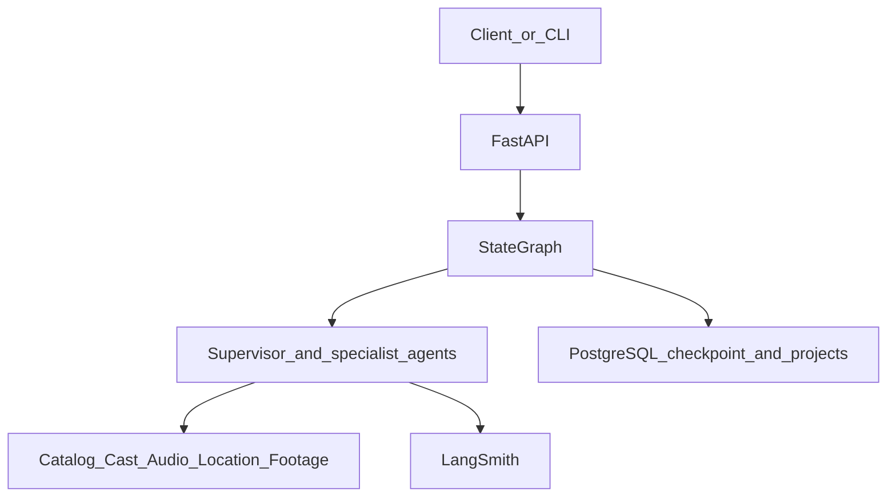
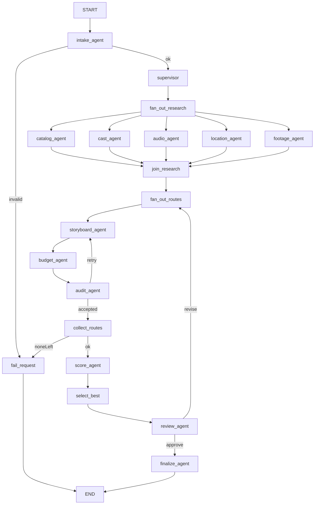

# graphMovie：AI 电影视频制作

用 LangGraph 做一部片子的制作方案，而不是旅游路线。输入题材、时长、预算和风格后，系统并行准备素材证据，再并行产出多套分镜方案，按可解释分数选出一套，并在人工确认处暂停。确认后导出分镜和预算；驳回则按意见回滚重做。

目录：`/Users/mingba/Documents/trunk/github/graphMovie`。Python 包名 `graphmovie`。

## 核心 LangGraph 特性

- `Send()`：主管按需求动态 fan-out，不每次启动全部 Agent。`footage_source=generated` 时不派发 `footage_agent`；只有 `stock` 才派发。修订时若研究证据仍然可用，只重跑分镜方案；意见里点名角色、配乐、场景或库存素材时，只重派对应研究 Agent。
- Checkpoint（`MemorySaver` / `PostgresSaver`）：`review_agent` 调用 `interrupt()`，这一步就是 `HumanReview`。同一张图可以 `compile(checkpointer=MemorySaver())` 或 `compile(checkpointer=PostgresSaver(...))`。测试和未配置数据库时用 `MemorySaver`；配置 `DATABASE_URL` 的 API 用 `PostgresSaver`。`thread_id` 等于 `project_id`，进程退出后可以续跑。同一项目上多次修订就是一条长对话制作迭代。
- State：`MovieState(TypedDict)` 是唯一共享状态。用户偏好、交付日期、时长、预算，以及所有 Agent 的返回数据都放在这里。节点只返回自己负责的增量字段。
- 条件边：校验失败或用户修改需求时回滚并重跑对应子图。`audit_agent` 失败时，该策略回到 `storyboard_agent`。`review_agent` 收到修订时回到分镜 fan-out；意见要求更换角色、配乐、场景或库存素材时，只重派对应研究 Agent。通过进入 `finalize_agent`，无法继续进入 `fail_request`。

## 业务对象

一部片子的制作方案包含：

- 需求：片名、类型、风格（`cinematic` / `anime` / `documentary`）、时长、预算、节奏（`relaxed` / `balanced` / `packed`）、素材来源（`generated` / `stock`）、交付日期
- 研究证据：镜头库、角色与配音、配乐音效、虚拟场景、库存画面
- 三套策略：`fast_social`（短镜头、低成本）、`balanced`、`cinematic`（长镜头、高规格）
- 每套方案：分镜列表、总时长、总预算、引用的报价 id
- 审计：幻觉镜头、错误标价
- 最终选定的一套分镜，可导出 Markdown 和 JSON

`storyboard_agent` 只编排镜头，不写价格。`budget_agent` 只按镜头库和报价 id 填金额，不改分镜。幻觉记在分镜节点上，标错价格记在预算节点上。

## 五层



- 接入层：`graphmovie/api.py`。`POST /projects` 开始制作规划，`GET /projects/{id}` 查看状态，`POST /projects/{id}/resume` 提交确认或修订，`GET /projects/{id}/export` 下载 Markdown 或 JSON。CLI 调用同一套 `MovieService`。
- 图引擎层：`graphmovie/graph.py`。`thread_id` 等于 `project_id`。
- Agent 层：主管、研究 Agent、分镜、预算、审计、评分、评审、落档。
- Tool 层：`graphmovie/tools/`。协议在 `base.py`，默认本地适配器读 `graphmovie/data/`。
- 观测与存储层：LangSmith、PostgreSQL 项目档案、Tool 返回值上的 `cache_hit`。

## 图



`supervisor` 用 `Send()` 派出的研究 Agent：

- 始终包含 `catalog_agent`、`cast_agent`、`audio_agent`、`location_agent`。
- 只有 `footage_source=stock` 才包含 `footage_agent`。纯生成成片不查库存镜头。

研究阶段并行。`join_research` 等齐已派发的分支后，再按 `fast_social`、`balanced`、`cinematic` 并行进入分镜。每条策略内部顺序固定：`storyboard_agent`、`budget_agent`、`audit_agent`。审计失败时该策略最多回到 `storyboard_agent` 两次，仍失败则丢弃该策略。

修订时 `revision_round` 加 1，上限 3。超过上限进入 `fail_request`。回流前用 `Overwrite` 清空本轮分镜草稿、标价、审计、候选和分数，保留需求和研究证据。意见未点名研究 Agent 时，研究阶段不重跑。点名「角色 / 配音」「配乐 / 音效」「场景 / 置景」「库存 / 航拍 / 素材片」「素材库 / 风格」时，`supervisor` 只重发对应 Agent。

条件边的回滚范围：

- `intake_agent` 校验失败进入 `fail_request`，不派发任何专业 Agent。
- `audit_agent` 的 `decision=retry` 只回滚当前策略的分镜子图。
- `review_agent` 的 `revise` 回滚全部分镜子图。需要更换研究证据时，再额外重派对应研究 Agent。
- `approve` 进入 `finalize_agent`。没有任何候选通过时进入 `fail_request`。

## 共享状态

```python
class MovieState(TypedDict, total=False):
    request: dict                      # 偏好、delivery_date、时长、预算、project_id
    dispatch: list[str]
    dispatch_log: Annotated[list, operator.add]
    catalog: list[dict]                # catalog_agent
    cast: list[dict]                   # cast_agent
    audio: list[dict]                  # audio_agent
    locations: list[dict]              # location_agent
    footage: list[dict]                # footage_agent
    drafts: Annotated[list[dict], operator.add]
    priced_routes: Annotated[list[dict], operator.add]
    audits: Annotated[list[dict], operator.add]
    candidates: Annotated[list[dict], operator.add]
    scores: dict
    best_strategy: str | None
    selected_plan: dict | None
    revision_round: int
    revision_notes: str | None
    review_decision: str | None
    final_plan: dict | None
    error: str | None
    status: str
```

`candidates` 只接收审计通过的方案。修订回滚时，带 reducer 的列表用 `Overwrite([])` 整表替换。

## Agent 与 LangSmith

父 run 的 metadata 带 `project_id`。研究 Agent 各是一条并行子 run。每条策略再展开 `storyboard_agent`、`budget_agent`、`audit_agent`。节点用 `add_node(..., metadata={"agent": 节点名})` 注册。

- `intake_agent` 校验片名、类型、风格、时长、预算、节奏和素材来源，输出拒绝原因。
- `supervisor` 输出实际 `Send` 的 Agent 名称，并追加到 `dispatch_log`。
- `catalog_agent`、`cast_agent`、`audio_agent`、`location_agent`、`footage_agent` 只调用自己的 Tool，把条目和 `cache_hit` 写入状态。
- `storyboard_agent` 只生成镜头顺序和文案，不写价格。镜头 id 必须来自研究证据。
- `budget_agent` 只按目录价和报价 id 填写金额，不改分镜。
- `audit_agent` 输出 `hallucinations` 与 `price_errors`。
- `score_agent` 输出分项分数和淘汰原因。
- `select_best` 写下推荐策略。并列时按 `balanced`、`fast_social`、`cinematic` 打破。
- `review_agent` 是 `HumanReview`。`interrupt()` 暂停后，LangSmith 里能看到中断载荷和 resume 值。
- `finalize_agent` 把最终分镜写入 `final_plan`，状态改为 `approved`。

`hallucinations` 记录分镜使用、但镜头库、场景和库存证据里都不存在的镜头，例如「不存在的月球歌剧院」。`price_errors` 记录预算节点填写的金额与目录价不一致的镜头，包含证据价、填写价和差额。有任一条且该策略尝试次数未超过 2 次，则 `decision=retry`，条件边回到 `storyboard_agent`。

查价错误时打开该策略的 `budget_agent`。查幻觉时打开 `storyboard_agent`，再用同一次运行的 `audit_agent` 看被标出的名称。

追踪环境变量：`LANGSMITH_TRACING=true`、`LANGSMITH_API_KEY`、`LANGSMITH_PROJECT=graphmovie`。未配置 Key 时服务仍可运行，审计结果保存在项目档案中。

未设置 `GRAPHMOVIE_USE_LLM=1` 时，分镜使用离线规划器，只从研究证据里选镜头。设置该变量并配置 `OPENAI_API_KEY` 或 `OPENAI_BASE_URL` 后，分镜可以走兼容接口，输出仍必须通过 `audit_agent`。

## Tool 接口

`graphmovie/tools/base.py` 定义 `CatalogTool`、`CastTool`、`AudioTool`、`LocationTool`、`FootageTool`。`TOOL_BACKEND=local` 选择 `graphmovie/tools/local.py`。本地数据放在 `graphmovie/data/`：`catalog.json`、`cast.json`、`audio.json`、`locations.json`、`footage.json`。

每个调用先查进程内缓存。返回值带 `cache_hit`、`source` 和稳定 id。`budget_agent` 只能引用这些 id。

## 择优

权重默认 cost 0.35、time 0.20、style_fit 0.30、pace_fit 0.15。

- cost：花费不超过预算时为 `1 - total_cost / budget`。超出预算的方案淘汰。
- time：成片时长相对需求时长的接近程度。
- style_fit：镜头标签对用户风格的覆盖率。
- pace_fit：平均镜头时长相对节奏目标（relaxed 8 秒、balanced 5 秒、packed 3 秒）的接近程度。

## 持久化与接口

`docker-compose.yml` 启动 PostgreSQL。`DATABASE_URL` 同时给 `PostgresSaver` 和项目档案表 `movie_projects` 使用，档案表与检查点表分开。未配置 `DATABASE_URL` 时，检查点用 `MemorySaver`，档案用本地 SQLite，方便单机运行和测试。

```bash
docker compose up -d
pip install -e ".[postgres,llm,dev]"
uvicorn graphmovie.api:app --reload
python -m graphmovie plan \
  --title 雨夜霓虹 --genre 科幻 --style cinematic \
  --duration 60 --budget 8000 --pace balanced \
  --footage generated --decision approve
```

`POST /projects/{id}/resume` 的正文是 `{"decision":"approve"}` 或 `{"decision":"revise","notes":"镜头再短一点"}`。图暂停时 `GET /projects/{id}` 返回 `status=interrupted`，以及候选分镜、分数和推荐策略。

## 目录

```text
graphMovie/
  ARCHITECTURE.md
  docker-compose.yml
  pyproject.toml
  README.md
  .env.example
  graphmovie/
    api.py
    cli.py
    config.py
    graph.py
    state.py
    scoring.py
    store.py
    export.py
    llm.py
    tracing.py
    service.py
    tools/
      base.py
      local.py
    nodes/
      intake.py
      supervisor.py
      research.py
      storyboard.py
      budget.py
      audit.py
      score.py
      review.py
      finalize.py
      fail.py
    data/
      catalog.json
      cast.json
      audio.json
      locations.json
      footage.json
  tests/
    test_scoring.py
    test_audit.py
    test_graph.py
    test_api.py
```

## 依赖

- Python `>=3.10`
- `langgraph`（含 `MemorySaver`）
- 可选 `langgraph-checkpoint-postgres`、`psycopg[binary]`
- 可选 `langchain-openai`、`langsmith`
- `fastapi`、`uvicorn`、`pydantic`、`python-dotenv`

从 PyPI 安装，不接入 langgraph monorepo。

## 验收

- `footage_source=generated` 的运行结果里，`dispatch_log` 不包含 `footage_agent`。`stock` 才包含它。
- `POST /projects` 后，已派发的研究 Agent 把镜头库、角色、配乐、场景、库存画面写入 `MovieState`；三条策略都能汇聚。
- 注入未知镜头时，只有 `storyboard_agent` 的草稿和 `audit_agent.hallucinations` 包含它，条件边回到该策略的 `storyboard_agent`。注入错误金额时，只有 `price_errors` 包含它，并标在 `budget_agent` 上。
- 全部超预算时 `status=failed`。
- `MemorySaver` 测试里，`HumanReview` 暂停后可以用同一 `project_id` 恢复。配置 PostgreSQL 后，进程退出再 resume 能从 `PostgresSaver` 继续。
- 同一 `project_id` 提交「镜头再短一点」后，`revision_round` 增加，分镜子图重跑，研究证据保留，`dispatch_log` 不新增。提交「更换角色」后，只重派 `cast_agent`。
- `GET /projects/{id}/export` 返回已确认分镜的 Markdown 和 JSON。

## 实现顺序

1. 包、配置、PostgreSQL 与本地镜头库数据。
2. Tool 协议、本地适配器和缓存标记。
3. `MovieState`、主管 `Send()`、两段并行图和条件边回滚。
4. `MemorySaver` / `PostgresSaver`、`HumanReview`、FastAPI、项目档案、CLI 和导出。
5. 离线分镜规划器、可选模型适配和 LangSmith metadata。
6. README 与测试。

## Celery 与工程化

- `POST /jobs/plan`、`POST /jobs/{id}/resume`、`GET /jobs/{task_id}` 把图执行放到 Celery worker
- Broker / result 使用 Redis；`docker compose up -d redis postgres` 后可本地起 worker
- 同步 `/projects*` 保留给 CLI 与本地调试
- 非 eager 的 `resume` 未配置 `DATABASE_URL` 时，入队前抛出 `SharedCheckpointerRequired`
- API：`GRAPHMOVIE_API_KEYS` 鉴权、`GRAPHMOVIE_RATE_LIMIT_PER_MINUTE` 限流、`GRAPHMOVIE_REQUEST_TIMEOUT_SEC` 超时
- Celery 任务软/硬超时：`CELERY_SOFT_TIME_LIMIT` / `CELERY_TIME_LIMIT`
- CI：`.github/workflows/ci.yml` 在 push/PR 上跑 `pytest`

## 范围边界

本地适配器是 Tool 的正式默认实现，接口按以后替换真实素材供应商、配音和生成视频服务来设计。

本仓库交付物是**制片规划**（分镜、预算、评审、导出），不是视频 SaaS 成品。不包含：

- 前端页面
- 向量库
- 真实模型视频账号 / 成片渲染流水线
- 账号体系、支付、CDN 分发

这些属于产品下一阶段，不应混进当前 LangGraph 编排内核。
